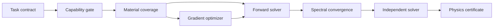

<div align="center">

# VeriTMM

### Verifier-first multilayer optics and inverse design

[](https://github.com/Lihonggang-scnu/VeriTMM/actions/workflows/ci.yml)
[](https://www.python.org/)
[](LICENSE)
[](THIRD_PARTY_NOTICES.md)

**[中文说明](README.zh-CN.md) · [Architecture](docs/ARCHITECTURE.md) · [Validation](docs/VALIDATION.md) · [Examples](examples/tmm_tasks)**

</div>

VeriTMM is a research-grade Python workbench for planar, isotropic,
one-dimensional multilayer optics. It joins stable forward simulation,
mixed-coherence physics, governed material data, differentiable inverse design,
convergence checks, independent cross-validation, and machine-readable physics
certificates in one reproducible task protocol.

The central idea is simple: **an optimizer may propose a design, but it may not
certify itself**. Every result—forward or optimized—passes through the same
deterministic physics checks before it is accepted.


## Why this project exists

Most TMM examples stop after producing an `R/T` curve. A scientific workflow
also needs to answer: Which material dataset was used? Was it extrapolated? Did
the spectrum converge? Does a second implementation agree? Is the requested
problem even inside scalar TMM's validity domain? Can the result be replayed?

VeriTMM makes those questions part of the executable contract rather than
leaving them to manual interpretation.

## Highlights

| Capability | What is implemented |
|---|---|
| Stable forward physics | Coherent S-matrix solver, characteristic-matrix diagnostic path, and Byrnes reference backend |
| Broad multilayer tasks | Thin films, DBRs, 1D photonic crystals, defect cavities, chirped stacks, absorbers and finite substrates |
| Illumination | Multi-wavelength, multi-angle, s/TE, p/TM and unpolarized calculations |
| Mixed coherence | Coherent films combined with optically thick/incoherent layers |
| Observables | R/T/A, complex amplitudes, fields, layer absorption, ellipsometry, system emissivity, phase and dispersion |
| Material governance | Explicit dataset identity, range checks, provenance and fail-closed extrapolation policy |
| Optical database | Bundled refractiveindex.info snapshot: 2,712 pages, 252,442 n points and 209,839 k points |
| Inverse design | Batched PyTorch S-matrix, multiband thickness optimization, fabrication bounds, multistart and quantization |
| Scientific verification | Capability gate, energy/passivity checks, spectral refinement and independent-solver comparison |
| Reproducibility | Immutable JSON tasks, normalized inputs, result manifests, CSV spectra and acceptance certificates |

## What we contribute

The transfer-matrix method is established physics. VeriTMM's contribution
is not a claim to have invented TMM; it is the **verifier-first integration** of
the following components:

1. A single, immutable task language shared by simulation and inverse design.
2. Explicit capability boundaries that reject gratings, metasurfaces,
   anisotropy, nonlinear optics and other unsupported physics with typed reasons.
3. Material selection as a reproducible scientific decision: provider, dataset
   ID, wavelength coverage, interpolation policy and source metadata travel with
   the result.
4. Independent recomputation of differentiable proposals before acceptance.
5. A physics certificate that records convergence, cross-solver agreement,
   energy balance, limitations and input identity.
6. A deliberate separation between target score and physical validity: an
   ambitious target may be missed without turning a correct calculation into a
   false failure—or a high score into false proof.

## Installation

```bash
git clone https://github.com/Lihonggang-scnu/VeriTMM.git
cd VeriTMM
python -m pip install -e .
```

For differentiable optimization and plots:

```bash
python -m pip install -e ".[optimize,plot]"
```

## Quick start

### Python API

```python
from tmm_engine import (
    IlluminationSpec, LayerSpec, MaterialRegistry, MediumSpec, SimulationTask,
    SpectralGrid, StackSpec, TMMWorkbench,
)

task = SimulationTask(
    stack=StackSpec(
        incident=MediumSpec.air(),
        layers=(
            LayerSpec(material="tio2", thickness_nm=90),
            LayerSpec(material="sio2", thickness_nm=140),
        ) * 6,
        exit=MediumSpec(material="sio2"),
        name="visible_dbr",
    ),
    spectrum=SpectralGrid(start_nm=400, stop_nm=800, points=401),
    illumination=IlluminationSpec(
        angles_deg=(0.0, 30.0),
        polarizations=("s", "p"),
    ),
)

result = TMMWorkbench(MaterialRegistry()).simulate(task)
print(result.audit)
```

### Reproducible JSON task

```bash
python scripts/run_tmm_task.py \
  --input examples/tmm_tasks/periodic_dbr_simulation.json \
  --output-dir outputs/dbr
```

The run writes:

- `NORMALIZED_TASK.json`
- `SIMULATION_RESULT.json`
- `SPECTRA.csv` and, when Matplotlib is installed, `SPECTRA.png`
- `PHYSICS_ACCEPTANCE_CERTIFICATE.json`
- `RUN_MANIFEST.json`

### Search the bundled material catalog

```bash
python scripts/search_optical_material.py TiO2 \
  --provider rii --start-nm 500 --stop-nm 800 --limit 5
```

Select a `dataset_id` explicitly when reproducing research results. The registry
does not silently extrapolate optical constants beyond their measured range.

### Differentiable inverse design

```bash
python scripts/run_tmm_task.py \
  --input examples/tmm_tasks/antireflection_optimization.json \
  --output-dir outputs/antireflection
```

The PyTorch optimizer proposes thicknesses; the NumPy/reference workbench then
recomputes the design, validates target evaluation, and issues the certificate.

## Verification model



The raw numerical output is never clipped to hide a physical violation.
Unsupported tasks and out-of-range data fail with explicit diagnostics. See
[the validation guide](docs/VALIDATION.md) for the current acceptance layers.

## Tested scientific scope

- coherent and mixed-coherence planar stacks;
- periodic and chirped multilayers, DBRs and defect cavities;
- lossy absorbers and finite thick substrates;
- angular and polarization response;
- layer-resolved absorption, ellipsometry and field profiles;
- phase, group delay, group-delay dispersion and Bloch-band diagnostics;
- deterministic thickness-tolerance Monte Carlo analysis;
- differentiable multiband thickness optimization.

The regression suite also reproduces the stop-band, defect-mode and field-
enhancement trends of a published multilayer cavity example. This is a
trend-level software validation, not a claim of exact fabrication replication.

## Deliberate boundaries

This is a scalar, isotropic, planar 1D solver. It does **not** claim to model
lateral gratings, metasurface unit cells, diffraction orders, anisotropic
tensor layers, nonlinear optics, diffuse scattering, finite beams, 3D near
fields, thermal transport or fabrication chemistry. Use RCWA, Berreman 4×4,
FDTD or FEM when those effects are essential.

## Testing

```bash
python -m pip install -e ".[test]"
python -m pytest -q
```

PyTorch-specific tests are automatically skipped when the optional optimizer
dependency is absent.

## Data, citation and license

Project code is MIT-licensed. The bundled refractiveindex.info data are CC0;
the runtime Byrnes `tmm` dependency is MIT-licensed. See
[THIRD_PARTY_NOTICES.md](THIRD_PARTY_NOTICES.md) for attribution and citation
requirements. When publishing scientific results, cite the original optical-
constant datasets selected by your run—not only this software.

## Status

`v0.1.0` is the first standalone release. The physics engine and deterministic
tests are usable; the public API may still evolve before `v1.0`.
