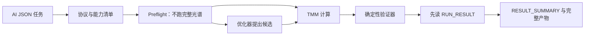

<div align="center">

# VeriTMM

### 面向 AI 自主科研的可验证 TMM 多层膜光学工具

[](https://github.com/Lihonggang-scnu/VeriTMM/actions/workflows/ci.yml)
[](https://www.python.org/)
[](LICENSE)
[](THIRD_PARTY_NOTICES.md)

**[English](README.md) · [系统架构](docs/ARCHITECTURE.md) · [验收机制](docs/VALIDATION.md) · [AgentBench](docs/AGENTBENCH.md) · [示例任务](examples/tmm_tasks)**

</div>

VeriTMM 首先且始终是一个面向平面、各向同性、一维分层光学问题的
**传输矩阵法（TMM）工具**。它的特色不是脱离 TMM 去构造一套宽泛的科研流程，
而是把成熟的 TMM 物理能力封装成更适合 AI 自主科研调用的计算工具：稳定正向
求解、混合相干传播、材料数据治理、可微逆向设计、光谱收敛检查、独立求解器
复算和机器可读物理证书，共享同一种可复现任务协议。

当前 v0.5 候选版在 TMM 核心外建立了一套确定性的 AI 实验工作台：能力发现、
JSON Schema 合同、不运行完整光谱的 preflight、typed failure、可审计运行产物、
实验存储、参数扫描、灵敏度/容差分析、稳健厚度优化和离线 AgentBench。
它仍是一套 TMM 执行与验证工具，不是通用科研工作流、外部求解器编排器或
LLM 内核。

项目的核心原则是：**AI 提出方案，TMM 负责计算，确定性验证器负责裁决。**
AI 智能体和优化器都不能给自己的方案颁发合格证；无论结果来自正向计算还是
梯度优化，都必须重新进入确定性物理验收。


## 为什么要做这个项目

传统 TMM 工具通常默认由人类专家选择合法输入、阅读警告并解释结果。AI 自主
科研则需要更严格的工具接口：用了哪一份材料数据？有没有外推？光谱是否
收敛？第二套实现能否复现？任务是否超出了标量 TMM 的能力边界？脱离当前
对话以后，结果能否被另一智能体或另一台机器重放？

VeriTMM 把这些问题从“使用者自己注意”变成可执行、可审计、机器可读的
TMM 合同。它的数值核心依然是 TMM，额外工程使这个核心更容易被 AI 正确调用，
也更难被 AI 误用。

## 核心能力

| 能力 | 当前实现 |
|---|---|
| 稳定正向求解 | 相干 S 矩阵主求解器、特征矩阵诊断路径、Byrnes 独立参考后端 |
| 多层膜任务 | 薄膜、DBR、一维光子晶体、缺陷腔、啁啾膜、吸收体和有限厚基底 |
| 入射条件 | 多波长、多角度、s/TE、p/TM 和非偏振光 |
| 混合相干 | 相干薄膜与光学厚层/非相干层统一计算 |
| 输出量 | R/T/A、复振幅、场分布、逐层吸收、椭偏、系统发射率、相位与色散 |
| 材料治理 | 数据集身份、适用波段、来源、插值策略和禁止静默外推 |
| 本地光学数据库 | refractiveindex.info 快照：2,712 个数据页、252,442 个 n 点、209,839 个 k 点 |
| 逆向设计 | PyTorch 批量可微 S 矩阵、多波段厚度优化、制造边界、多起点和厚度量化 |
| 物理验收 | 能力边界、无源性/能量、光谱收敛和独立求解器一致性检查 |
| 面向 AI 的协议 | 能力发现、五类任务 schema、确定性 preflight、typed failure 和 JSON 运行信封 |
| 可复现实验 | `ExperimentStore`、内容感知缓存、谱系、对比、有限参数扫描与断点续跑 |
| 科学分析 | 经独立差分复核的厚度灵敏度、固定随机种子的容差/良率分析和 Wilson 区间 |
| 稳健逆向设计 | 随机训练目标、独立蒙特卡洛终验和按角色保留候选方案 |
| 智能体评测 | 80+ 个确定性案例、超范围任务误接收统计和与框架无关的 A/B 轨迹 |
| 可复现性 | 不可变 JSON 任务、规范化身份、紧凑摘要、完整产物和物理证书 |

## 我们真正贡献了什么

传输矩阵法是成熟的基础物理，本项目不声称发明了新的 TMM 方程，也不把自己
包装成通用科研工作流。我们的贡献是提供一套**面向 AI 调用的 TMM 工具接口**：

1. 仿真和逆向设计共享机器可读的不可变任务协议，AI 不必依赖隐含对话记忆；
2. 能力协议会用结构化原因明确拒绝光栅、超表面、各向异性、非线性等
   超出范围的问题；
3. 材料选择成为可追溯的科研决策，数据来源、编号和波段随结果保存；
4. AI 或可微优化器提出的厚度必须由独立路径重新计算；
5. 每次合格运行生成机器可读的物理验收证书，记录收敛、能量、一致性、
   输入身份和限制条件；
6. 把“目标得分”与“物理可信”彻底分开——未达到理想指标不等于计算错误，
   高分也不能代替物理证明。

当前命令面让这份合同不依赖对话状态即可调用。引擎不依赖特定大模型、
智能体框架、外部求解器或 LLM 运行时。

VeriTMM 不依赖特定大模型或智能体框架。任何能够生成标准 JSON 任务并读取
结构化结果的 AI 系统，都可以把它作为确定性的多层膜光学计算工具。

## 面向 AI 的职责边界

| AI 负责 | VeriTMM 负责 |
|---|---|
| 提出膜系、材料、目标或厚度更新 | 在计算前校验并规范化任务 |
| 请求正向仿真或可微优化 | 在声明的能力边界内执行对应 TMM 路径 |
| 根据结果继续迭代 | 保存可复现输入、输出和结构化失败原因 |
| 选择有潜力的候选方案 | 独立复算并生成物理验收证书 |
| 提出超出 TMM 范围的任务 | 明确拒绝，而不是返回一条看似合理的错误光谱 |

这种分工是有意设计的：AI 提供科研策略和候选方案，VeriTMM 提供确定性的
TMM 计算、受控执行与物理核验。

## v0.5 命令行协议

安装后的 `veritmm` 命令是面向机器的公共入口：

```bash
veritmm describe --json
veritmm schema simulation
veritmm schema optimization
veritmm schema sweep
veritmm schema sensitivity
veritmm schema tolerance
veritmm preflight task.json --json
veritmm run task.json --output-dir outputs/tmm_run --json
veritmm history --json
veritmm inspect RUN_ID --json
veritmm lineage RUN_ID --json
veritmm compare RUN_A RUN_B --json
veritmm benchmark --offline --json
```

`describe` 返回当前能力清单；`schema` 命令导出 JSON Schema 合同。
`preflight` 检查任务合同、TMM 能力边界、材料在完整声明波长网格上的覆盖、后端路由和数值风险提示，
**不会运行完整光谱，也不会运行优化**。`run` 会先执行 preflight，再由 TMM
计算，并交给确定性验证器。

`RUN_RESULT.json` 是一次运行的第一入口，包含状态、失败信息、证书身份、产物引用
和下一步机器动作。随后先读 `RESULT_SUMMARY.json` 获取紧凑的光谱特征和物理摘要；
在决定下一步之前，不必先吞下完整的 `SIMULATION_RESULT.json` 或 `SPECTRA.csv`。
需要深入科研分析时，再读取完整产物。

### 面向上下文效率的响应档位

面向机器的 CLI 和 Python 执行响应默认使用 `compact`。同一个统一的
`RUN_RESULT.json` 入口支持显式请求更丰富的附加投影：

```bash
veritmm run task.json --output-dir outputs/tmm_run --json --detail compact
veritmm run task.json --output-dir outputs/tmm_run --json --detail standard
veritmm run task.json --output-dir outputs/tmm_run --json --detail full
```

`compact` 只保留决策所需的状态、证书身份、有界指标、typed action 和有效的
相对产物引用；`standard` 提供有界诊断集合；`full` 保留更丰富的标量、映射和上下文。
`full` 也不是 raw：光谱、波长网格、R/T/A 通道数组、容差样本、优化历史、扫描子项、
benchmark case/trajectory 和完整 provenance 在所有档位都保持外置。运行响应通过带哈希的
产物引用访问这些内容；没有可到达引用时会报告 `artifact_backed: false`。档位记录在
`summary.response` 中，版本为 `veritmm-response-v1`；已有的 `veritmm-run-result-v1`
信封和任务 schema 保持兼容。

## 可复现实验与稳健性

同一个 `run` 入口可执行 sweep、sensitivity 和 tolerance 合同，示例位于
`examples/tmm_tasks/`。参数扫描会生成父运行、稳定的子任务、逐项产物和可恢复
检查点；灵敏度由可微后端计算，再用独立 NumPy 中心差分复核；容差 v2 将“已完成
样本中的条件良率”与“全部请求样本中的总体成功比例”分开，并记录计算失败分类。
稳健优化的训练与终验使用同一扰动边界语义，但随机训练只负责提出方案，正式候选
角色由新的独立蒙特卡洛评估决定；终验不完整的候选不能成为 `best_robust`。

本地 `ExperimentStore` 按 `run_id` 只追加记录；已有规范运行目录不会被合并或
覆盖，缓存复用也会创建新的运行身份。缓存复用参数扫描时，每个复制的子运行同样
获得新身份，同时明确保留来源父运行和来源子运行的追溯关系。

若独立稳健终验失败，标称候选仍可供检查，但 `best_robust`、`best_quantized`
以及兼容字段 `most_robust` 均保持为空，启发式筛选分数不会冒充正式稳健结论。

这些产物回答不同问题：`PHYSICS_ACCEPTANCE_CERTIFICATE.json` 只证明标称 TMM
结果通过物理和数值验收；`SENSITIVITY_RESULT.json`、`TOLERANCE_RESULT.json` 与
`ROBUSTNESS_REPORT.json` 分别描述扰动响应，不能相互冒充。

## 离线 AgentBench

```bash
veritmm benchmark --offline --json
```

AgentBench 不调用 LLM，也不访问网络。它检查案例合同、preflight 决策、失败代码、
运行产物、物理断言和重复运行一致性。发布闸门要求适用域外任务误接收率严格为
零。`tmm_engine.agent_harness` 提供与框架无关的 A/B 轨迹接口，可接外部 callable
或已有轨迹；核心包不依赖任何专有智能体 SDK。基准证据永远不能修改能力规则或
物理证书。

## 安装

```bash
git clone https://github.com/Lihonggang-scnu/VeriTMM.git
cd VeriTMM
python -m pip install -e .
```

需要可微优化和绘图时：

```bash
python -m pip install -e ".[optimize,plot]"
```

## 快速开始

### 面向 AI 的 JSON 任务

使用命令行协议完成确定性的机器交接：

```bash
veritmm preflight examples/tmm_tasks/periodic_dbr_simulation.json --json
veritmm run examples/tmm_tasks/periodic_dbr_simulation.json \
  --output-dir outputs/dbr --json --detail compact
```

运行会根据模式和设置写出 `RUN_RESULT.json`，以及可能的
`RESULT_SUMMARY.json`、`PREFLIGHT_REPORT.json`、`NORMALIZED_TASK.json`、
`PHYSICS_ACCEPTANCE_CERTIFICATE.json`、`SIMULATION_RESULT.json` 和
`SPECTRA.csv`。优化任务还会写出 `OPTIMIZATION_RESULT.json` 和
`INDEPENDENT_VALIDATION.json`、`DESIGN_PORTFOLIO.json` 和经过独立认证的候选
产物；光谱图是可选的。即使 preflight 拒绝，仍会生成
机器可读的运行信封和带 typed failure action 的失败信息。

### 运行标准 JSON 任务

```bash
python scripts/run_tmm_task.py \
  --input examples/tmm_tasks/periodic_dbr_simulation.json \
  --output-dir outputs/dbr
```

旧脚本名现在只是统一执行服务的兼容入口。系统会写出规范化任务、完整
仿真结果、CSV 光谱、运行清单、`RUN_RESULT.json`、`RESULT_SUMMARY.json`，以及
`PHYSICS_ACCEPTANCE_CERTIFICATE.json`。安装 Matplotlib 后还会生成光谱图。

对于 AI 调用，优先使用上面的 `veritmm run ... --json --detail compact` 接口：
`RUN_RESULT.json` 是第一入口，需要时再通过产物引用打开完整光谱。确实需要内嵌
诊断内容时，再显式使用 `--detail standard|full`。

### 检索本地材料数据库

```bash
python scripts/search_optical_material.py TiO2 \
  --provider rii --start-nm 500 --stop-nm 800 --limit 5
```

正式复现时应明确指定 `dataset_id`。材料波段不足时默认拒绝，不会偷偷
使用端点值外推。

### 可微逆向设计

```bash
python scripts/run_tmm_task.py \
  --input examples/tmm_tasks/antireflection_optimization.json \
  --output-dir outputs/antireflection
```

PyTorch 负责提出候选厚度；随后 NumPy/参考求解器会重新计算、校验目标并颁发
物理证书。系统还会分别保留性能、鲁棒性、易制造性和结构差异性候选，而不是
把所有价值压成一个总分。优化模型不能修改光谱或绕过验收。

简言之：**AI 提出方案，TMM 负责计算，验证器负责颁证**。优化器不能给自己的
候选方案认证。

## 验收链



程序不会通过裁剪光谱来掩盖负吸收、非有限数或能量异常。详细说明见
[验收机制](docs/VALIDATION.md)。

## 适用范围

- 相干与混合相干平面多层结构；
- 周期/啁啾多层膜、DBR、一维光子晶体和缺陷腔；
- 有损吸收膜和有限厚基底；
- 角度、偏振、逐层吸收、椭偏和场分布；
- 相位、群时延、群时延色散和 Bloch 禁带分析；
- 多波段可微与稳健厚度优化；
- 有限参数扫描与断点续跑、灵敏度复核、容差和良率研究。

## 明确不做什么

当前是标量、各向同性、平面一维求解器，不应拿来模拟横向光栅、超表面单元、
衍射级、各向异性张量、非线性光学、散射、有限光束、三维近场、热传输或
制造化学。遇到这些问题应切换 RCWA、Berreman 4×4、FDTD 或 FEM，而不是
强行让 TMM 给出看似完整的答案。

VeriTMM 不执行外部求解器，也不包含 LLM 内核。可选 MCP 传输层暂缓实现；
Python 和 CLI 协议无需 MCP 即可完整工作。这些边界不改变数值引擎以 TMM 为
核心的定位。

## 测试

```bash
python -m pip install -e ".[test]"
python -m pytest -q
```

没有安装 PyTorch 时，可微优化专项测试会自动跳过，其余物理测试照常运行。

## 数据、引用与许可证

项目代码采用 MIT 许可证；refractiveindex.info 数据为 CC0；Byrnes `tmm`
运行依赖采用 MIT 许可证。详情及推荐引用见
[THIRD_PARTY_NOTICES.md](THIRD_PARTY_NOTICES.md)。发表科研结果时，还应引用
本次运行实际选择的原始光学常数论文。

## 当前状态

`v0.5.2` 是当前本地加固候选版。它保持 v0.5.0 的求解器与验证边界，保留 v0.5.1
的来源与稳健性加固，并新增默认紧凑、由工件承载详细内容的响应档案。项目仍处于
`v1.0` 之前；公共 API 与协议细节仍可能继续演进，但已经声明的物理适用边界会继续
采用失败关闭原则。
