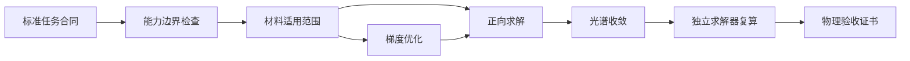

<div align="center">

# VeriTMM

### 面向 AI 自主科研的可验证 TMM 多层膜光学工具

[](https://github.com/Lihonggang-scnu/VeriTMM/actions/workflows/ci.yml)
[](https://www.python.org/)
[](LICENSE)
[](THIRD_PARTY_NOTICES.md)

**[English](README.md) · [系统架构](docs/ARCHITECTURE.md) · [验收机制](docs/VALIDATION.md) · [示例任务](examples/tmm_tasks)**

</div>

VeriTMM 首先且始终是一个面向平面、各向同性、一维分层光学问题的
**传输矩阵法（TMM）工具**。它的特色不是脱离 TMM 去构造一套宽泛的科研流程，
而是把成熟的 TMM 物理能力封装成更适合 AI 自主科研调用的计算工具：稳定正向
求解、混合相干传播、材料数据治理、可微逆向设计、光谱收敛检查、独立求解器
复算和机器可读物理证书，共享同一种可复现任务协议。

项目的核心原则是：**AI 提出方案，TMM 负责计算，确定性验证器负责裁决。**
AI 智能体和优化器都不能给自己的方案颁发合格证；无论结果来自正向计算还是
梯度优化，都必须重新进入确定性物理验收。


## 为什么要做这个项目

传统 TMM 工具通常默认由人类专家选择合法输入、阅读警告并解释结果。AI 自主
科研则需要更严格的工具接口：用了哪一份材料数据？有没有外推？光谱是否
收敛？第二套实现能否复现？任务是否超出了标量 TMM 的能力边界？脱离当前
对话以后，结果能否被另一智能体或另一台机器重放？

VeriTMM 把这些问题从“使用者自己注意”变成可执行、可审计、机器可读的
TMM 合同。它的数值核心依然是 TMM，额外工程使这个核心更容易被 AI 正确调用，
也更难被 AI 误用。

## 核心能力

| 能力 | 当前实现 |
|---|---|
| 稳定正向求解 | 相干 S 矩阵主求解器、特征矩阵诊断路径、Byrnes 独立参考后端 |
| 多层膜任务 | 薄膜、DBR、一维光子晶体、缺陷腔、啁啾膜、吸收体和有限厚基底 |
| 入射条件 | 多波长、多角度、s/TE、p/TM 和非偏振光 |
| 混合相干 | 相干薄膜与光学厚层/非相干层统一计算 |
| 输出量 | R/T/A、复振幅、场分布、逐层吸收、椭偏、系统发射率、相位与色散 |
| 材料治理 | 数据集身份、适用波段、来源、插值策略和禁止静默外推 |
| 本地光学数据库 | refractiveindex.info 快照：2,712 个数据页、252,442 个 n 点、209,839 个 k 点 |
| 逆向设计 | PyTorch 批量可微 S 矩阵、多波段厚度优化、制造边界、多起点和厚度量化 |
| 物理验收 | 能力边界、无源性/能量、光谱收敛和独立求解器一致性检查 |
| 可复现性 | 不可变 JSON 任务、规范化输入、CSV 光谱、运行清单和物理证书 |

## 我们真正贡献了什么

传输矩阵法是成熟的基础物理，本项目不声称发明了新的 TMM 方程，也不把自己
包装成通用科研工作流。我们的贡献是提供一套**面向 AI 调用的 TMM 工具接口**：

1. 仿真和逆向设计共享机器可读的不可变任务协议，AI 不必依赖隐含对话记忆；
2. 能力协议会用结构化原因明确拒绝光栅、超表面、各向异性、非线性等
   超出范围的问题；
3. 材料选择成为可追溯的科研决策，数据来源、编号和波段随结果保存；
4. AI 或可微优化器提出的厚度必须由独立路径重新计算；
5. 每次合格运行生成机器可读的物理验收证书，记录收敛、能量、一致性、
   输入身份和限制条件；
6. 把“目标得分”与“物理可信”彻底分开——未达到理想指标不等于计算错误，
   高分也不能代替物理证明。

VeriTMM 不依赖特定大模型或智能体框架。任何能够生成标准 JSON 任务并读取
结构化结果的 AI 系统，都可以把它作为确定性的多层膜光学计算工具。

## 面向 AI 的职责边界

| AI 负责 | VeriTMM 负责 |
|---|---|
| 提出膜系、材料、目标或厚度更新 | 在计算前校验并规范化任务 |
| 请求正向仿真或可微优化 | 在声明的能力边界内执行对应 TMM 路径 |
| 根据结果继续迭代 | 保存可复现输入、输出和结构化失败原因 |
| 选择有潜力的候选方案 | 独立复算并生成物理验收证书 |
| 提出超出 TMM 范围的任务 | 明确拒绝，而不是返回一条看似合理的错误光谱 |

这种分工是有意设计的：AI 提供科研策略和候选方案，VeriTMM 提供确定性的
TMM 计算、受控执行与物理核验。

## 安装

```bash
git clone https://github.com/Lihonggang-scnu/VeriTMM.git
cd VeriTMM
python -m pip install -e .
```

需要可微优化和绘图时：

```bash
python -m pip install -e ".[optimize,plot]"
```

## 快速开始

### 运行标准 JSON 任务

```bash
python scripts/run_tmm_task.py \
  --input examples/tmm_tasks/periodic_dbr_simulation.json \
  --output-dir outputs/dbr
```

系统会写出规范化任务、完整仿真结果、CSV 光谱、运行清单，以及最重要的
`PHYSICS_ACCEPTANCE_CERTIFICATE.json`。安装 Matplotlib 后还会生成光谱图。

### 检索本地材料数据库

```bash
python scripts/search_optical_material.py TiO2 \
  --provider rii --start-nm 500 --stop-nm 800 --limit 5
```

正式复现时应明确指定 `dataset_id`。材料波段不足时默认关闭失败，不会偷偷
使用端点值外推。

### 可微逆向设计

```bash
python scripts/run_tmm_task.py \
  --input examples/tmm_tasks/antireflection_optimization.json \
  --output-dir outputs/antireflection
```

PyTorch 负责提出候选厚度；随后 NumPy/参考求解器会重新计算、校验目标并颁发
物理证书。优化模型不能修改光谱或绕过验收。

## 验收链



程序不会通过裁剪光谱来掩盖负吸收、非有限数或能量异常。详细说明见
[验收机制](docs/VALIDATION.md)。

## 适用范围

- 相干与混合相干平面多层结构；
- 周期/啁啾多层膜、DBR、一维光子晶体和缺陷腔；
- 有损吸收膜和有限厚基底；
- 角度、偏振、逐层吸收、椭偏和场分布；
- 相位、群时延、群时延色散和 Bloch 禁带分析；
- 厚度误差蒙特卡洛与多波段可微厚度优化。

## 明确不做什么

当前是标量、各向同性、平面一维求解器，不应拿来模拟横向光栅、超表面单元、
衍射级、各向异性张量、非线性光学、散射、有限光束、三维近场、热传输或
制造化学。遇到这些问题应切换 RCWA、Berreman 4×4、FDTD 或 FEM，而不是
强行让 TMM 给出看似完整的答案。

## 测试

```bash
python -m pip install -e ".[test]"
python -m pytest -q
```

没有安装 PyTorch 时，可微优化专项测试会自动跳过，其余物理测试照常运行。

## 数据、引用与许可证

项目代码采用 MIT 许可证；refractiveindex.info 数据为 CC0；Byrnes `tmm`
运行依赖采用 MIT 许可证。详情及推荐引用见
[THIRD_PARTY_NOTICES.md](THIRD_PARTY_NOTICES.md)。发表科研结果时，还应引用
本次运行实际选择的原始光学常数论文。

## 当前状态

`v0.1.0` 是第一个独立开源版本。物理引擎和确定性测试已经可用，但在 `v1.0`
之前，部分公共接口仍可能调整。
