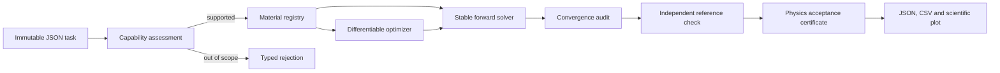

# Architecture

The optimizer is a proposal mechanism, not an authority. Every optimized stack
returns to the deterministic workbench and the same acceptance path used by a
forward simulation.

## Numerical backends

- **S-matrix:** default coherent solver, selected for numerical stability.
- **Characteristic matrix:** diagnostic backend for comparison and debugging.
- **Byrnes reference:** independent implementation for coherent cross-checks,
  mixed-coherence propagation, ellipsometry, fields, and layer absorption.
- **PyTorch differentiable S-matrix:** batched gradient path for thickness design;
  its output is independently recomputed before acceptance.

