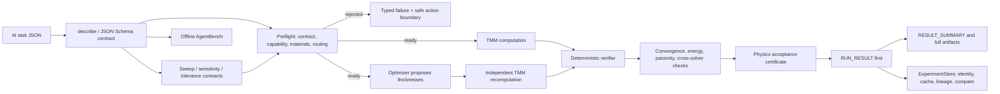

# Architecture

VeriTMM remains a TMM engine. Version 0.5 exposes a deterministic protocol,
reproducible experiment layer, scientific-analysis studies, and an offline
agent benchmark around that engine. It does not turn the project into a
generic scientific-research workflow, an external-solver orchestrator, or an
LLM runtime.

The roles are deliberately separate: **AI proposes, TMM computes, and the
verifier certifies**. The optimizer is a proposal mechanism, not an authority;
every optimized stack returns to independent recomputation and the same
acceptance path used by a forward simulation.

## Protocol boundary

- `veritmm describe --json` returns the machine-readable capability manifest.
- `veritmm schema simulation|optimization|sweep|sensitivity|tolerance` exports
  the public task contracts.
- `veritmm preflight task.json --json` validates the task, capability boundary,
  material coverage on the complete declared wavelength grid, backend routing, and
  numerical risk notices. It does not run a complete spectrum or optimization.
- `veritmm run task.json --output-dir ... --json` performs preflight, invokes
  the existing TMM/optimization paths, and writes the machine-facing envelope.

`RUN_RESULT.json` is the first-read artifact. It references the other files and
contains status, typed failures, certificate identity, and next machine actions.
`RESULT_SUMMARY.json` is intentionally compact so an agent can inspect physics
and spectral features without first ingesting the full spectrum. The full
`SIMULATION_RESULT.json` and `SPECTRA.csv` remain available for scientific
inspection.

`ExperimentStore` adds invocation identity, content-aware cache provenance,
parent/child lineage, history, and deterministic comparisons without putting
research metadata into a physics certificate. Sweep, sensitivity, tolerance,
and robust-optimization artifacts are separate scientific claims: a valid
physics certificate does not imply high manufacturing yield, and a high yield
does not replace physical verification.

## Numerical backends

- **S-matrix:** default coherent solver, selected for numerical stability.
- **Characteristic matrix:** diagnostic backend for comparison and debugging.
- **Byrnes reference:** independent implementation for coherent cross-checks,
  mixed-coherence propagation, ellipsometry, fields, and layer absorption.
- **PyTorch differentiable S-matrix:** batched gradient path for thickness design;
  its output is independently recomputed before acceptance.

The v0.5 protocol formally exposes finite sweep, thickness sensitivity, and
tolerance/yield operations. It still does not execute external solver families.
Unsupported geometry, material, excitation, or output combinations are
rejected with typed failures rather than routed silently. AgentBench observes
that behavior but has no authority to change it. The optional MCP layer is
deferred because the CLI and Python protocol are already complete transports.
